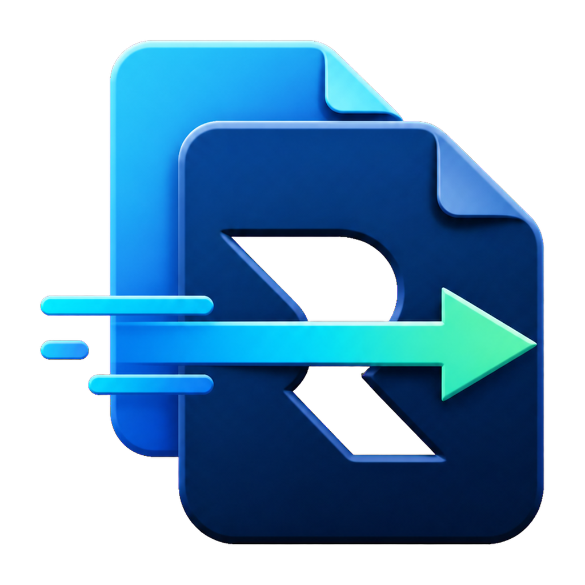

<p align="center">
  
</p>

<h1 align="center">RoboCopy Paste</h1>

<p align="center">
  让 Windows 资源管理器的文件 <kbd>Ctrl</kbd>+<kbd>V</kbd> 使用微软系统自带的 Robocopy。
</p>

<p align="center">
  <a href="https://github.com/lich-wang/RoboCopyPaste/releases/latest"></a>
  <a href="LICENSE"></a>
  
</p>

RoboCopy Paste 是一个轻量、便携的 Windows GUI 工具。当文件剪贴板处于活动状态，且前台窗口是资源管理器或桌面时，它接管 `Ctrl+V` 并调用 `C:\Windows\System32\robocopy.exe`。文字粘贴和其他应用仍交给 Windows；目标无法安全解析时也会自动回退。

> 当前为 v0.1.0 MVP。RDP 双端复制属于实验性功能，使用前请阅读下方限制。

## 功能

- 使用微软原生 `robocopy.exe`，不内置第三方复制引擎
- `/Z` 可恢复复制、多线程、重试和等待参数
- 文件与文件夹任务队列
- 覆盖确认、跳过已存在项目
- 实时输出、日志、取消任务和托盘运行
- 可选的当前用户开机启动
- 无法接管时安全回退 Windows 原生粘贴
- 实验性的 RDP 双端剪贴板协议和 `\\tsclient` 路径映射

## 下载

从 [Releases](https://github.com/lich-wang/RoboCopyPaste/releases/latest) 下载 `RoboCopyPaste-v0.1.0.zip`，解压后运行 `RoboCopyPaste.exe`。无需安装。

程序目前没有代码签名，Windows SmartScreen 可能显示“未知发布者”。

## 使用

1. 启动 `RoboCopyPaste.exe`，保持“启用接管”勾选。
2. 在资源管理器中照常选择文件并按 `Ctrl+C`。
3. 打开目标文件夹并按 `Ctrl+V`。
4. 在主窗口查看 Robocopy 命令、输出和返回码。

关闭窗口后程序仍在托盘运行。若要彻底恢复原生行为，请从主窗口或托盘菜单选择“退出”。

## 默认 Robocopy 参数

```text
/Z /COPY:DAT /DCOPY:DAT /XJ /MT:16 /R:3 /W:2 /TEE
```

| 参数 | 作用 |
| --- | --- |
| `/Z` | 可恢复模式，适合网络复制 |
| `/COPY:DAT` | 复制文件数据、属性和时间 |
| `/DCOPY:DAT` | 复制目录数据、属性和时间 |
| `/XJ` | 跳过目录联接，避免递归环 |
| `/MT:n` | 多线程复制，界面可设 1–128 |
| `/R:n /W:n` | 失败重试次数与等待秒数 |

文件夹任务额外使用 `/E`。Robocopy 返回码 0–7 视为成功，8 及以上视为失败。

## 远程桌面

跨 RDP 使用需要：

1. 本地和远程电脑运行相同版本的 RoboCopy Paste。
2. mstsc 的“本地资源 → 详细信息”启用“驱动器”重定向。
3. 组策略允许剪贴板和驱动器重定向。

本地到远程时，远程端会把客户端路径映射为 `\\tsclient\盘符\...` 后拉取文件。远程到本地时，本地端通过自定义剪贴板格式请求远程端写入客户端重定向驱动器。

该协议和路径映射已实现，但 v0.1.0 尚未在真实双机 RDP 环境完成验收。若自定义剪贴板格式被拦截、两端版本不同或驱动器未重定向，程序会尽量回退 Windows。

## 当前限制

- `Ctrl+C` 仍由 Windows 处理；程序只在粘贴阶段接管
- `Ctrl+X`、右键“粘贴”和拖放暂不走 Robocopy
- 库、回收站等虚拟目录可能回退到 Windows
- 提权的资源管理器可能受 Windows 完整性级别限制
- 其他软件若已全局注册 `Ctrl+V`，接管将无法启用

## 设置和日志

```text
%LOCALAPPDATA%\RoboCopyPaste\
├── settings.ini
└── logs\YYYY-MM-DD.log
```

如果此目录不可写，程序回退到可执行文件旁边的 `data` 目录。开机启动默认关闭；启用后仅写入当前用户的 `HKCU\Software\Microsoft\Windows\CurrentVersion\Run`。

## 从源码构建

要求：Windows 10/11 和系统自带的 .NET Framework C# 编译器。

```powershell
git clone https://github.com/lich-wang/RoboCopyPaste.git
cd RoboCopyPaste
powershell.exe -NoProfile -ExecutionPolicy Bypass -File .\build.ps1
```

构建产物为仓库根目录下的 `RoboCopyPaste.exe`。

## 验证

- Windows 11 x64 构建通过
- 实际调用系统 Robocopy，返回码 1
- 复制后文件 SHA-256 与源文件一致
- 已验证资源管理器目标解析、热键消息、队列、取消、日志和托盘界面

## 参与贡献

欢迎提交 Issue 和 Pull Request。提交前请确保 `build.ps1` 可以成功构建，并避免把个人设置、日志或测试文件加入仓库。

## 许可证

[MIT](LICENSE)
